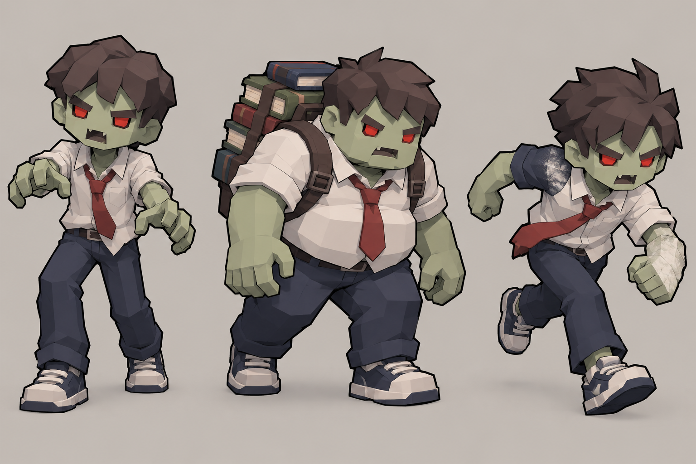
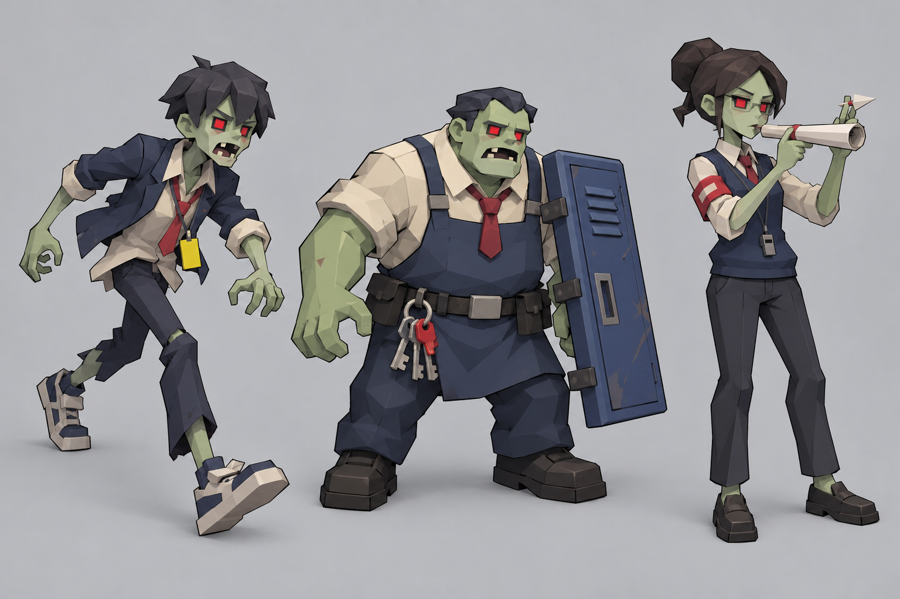
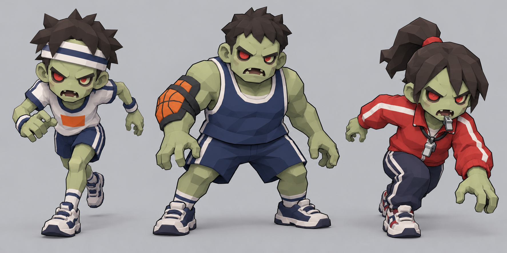
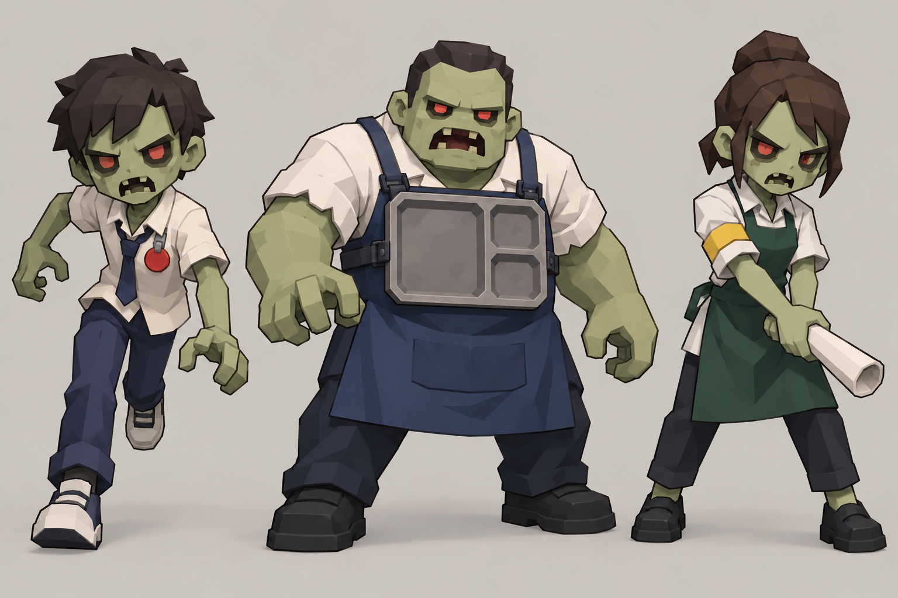

# Stage 1–4 스테이지별 좀비 콘셉트 기획

작성일: 2026-10-23
상태: 기획 제안 및 콘셉트 원화. 런타임 반영·스탯 승인·모델 제작 완료를 뜻하지 않는다.

## 기획 기준

현재 코드에서 쓰는 좀비의 전투 역할과 표현 방식을 먼저 확인하고, 각 스테이지의 장소와 플레이 압박을 캐릭터의 실루엣·복장·소품에 반영했다. 스테이지마다 3종, 총 12종이다. 새 능력이나 숫자를 발명하지 않고, 이미 동작 중인 기본 추격·러너·탱커/엘리트·원거리·차저 중 하나를 참고 역할로만 연결한다. 아래 E 코드 연결은 행동 문법을 설명하기 위한 참고이며, 새 좀비에 그 ID나 전투 수치를 확정 배정한 것이 아니다.

실제 공통 구현 흐름은 [시각 구현 방식 기록](../Graphic_designer/stage_zombie_visual_method_20261023.md)에 정리했다. 핵심은 기존의 챔퍼 박스 파츠, 공용 툰 재질·외곽선, 어깨·골반 피벗, 역할별 기존 애니메이션과 인스턴스 경로를 그대로 이용하는 것이다. 원화는 외형 아이디어를 읽기 위한 그림이며 게임 모델·텍스처·리깅 결과물이 아니다.

## 스테이지별 콘셉트

### Stage 1 — 교실 생존

현재 이름은 `교실 생존`이다. 교실에서 기본 추격과 밀도, 빠른 적, 탱커, 차저·거대 적의 조합으로 생존 압박을 만든다. B01 수학 교사는 보스이므로 이번 일반 좀비 3종에는 포함하지 않는다.

| 콘셉트 | 참고 행동 | 실루엣·외형 |
|---|---|---|
| 지각생 추격 좀비 | 기본 추격 E01 | 느슨한 셔츠와 비뚤어진 넥타이, 한쪽으로 기운 사각 머리. 팔을 앞으로 내민 익숙한 학생 실루엣으로 기본 접근 위협을 읽게 한다. |
| 책가방 벽 좀비 | 탱커 E02 | 상체는 넓고 단단한 한 덩어리로 유지한다. 책을 낮게 묶은 가방을 등에 붙여 무게를 표현하고, 책이 몸 주위를 떠다니거나 방패처럼 충돌을 막는 인상은 피한다. |
| 분필 돌진 좀비 | 차저 E05 | 몸을 진행 방향으로 숙인 학생. 소매와 신발에 짧은 분필 가루색 포인트를 두어 차저 실루엣을 강조한다. 분필 가루는 장식이며 별도 장판·공격 효과가 아니다. |

### Stage 2 — 복도 투사체 시험

현재 이름은 `복도 투사체 시험`이다. 길고 좁은 복도에서 원거리 투사체와 근접 추격이 겹치므로, 달리는 실루엣·통로를 차지하는 몸집·조준 자세를 분명히 나눈다. 기존 경비원 추격 크루와 B02 보스의 외형을 그대로 복제하지 않는다.

| 콘셉트 | 참고 행동 | 실루엣·외형 |
|---|---|---|
| 복도 전령 러너 | 러너 E03 | 가는 재킷과 흔들리는 학생증 끈, 길게 뻗은 한 발로 속도를 읽게 한다. 벽·사물함을 가리는 큰 장비는 붙이지 않는다. |
| 사물함 문 탱커 | 탱커/엘리트 E02 또는 E06 | 넓은 작업 앞치마와 한쪽 팔에 밀착된 사물함 문 조각으로 무게를 표현한다. 문은 장식 파츠이며 가드·밀치기 같은 새 행동을 뜻하지 않는다. |
| 복도 안내문 사수 | 원거리 E04 | 복도 안내 담당 학생의 완장과 말아 쥔 종이 안내문으로 조준 역할을 구분한다. 원화의 종이 다트는 외형 참고일 뿐 현재 투사체의 외형·발사 방식·피해를 변경하라는 뜻이 아니다. |

### Stage 3 — 체육관 총력전

현재 이름은 `체육관 총력전`이다. 체육관 아레나의 전방위·다축 압박과 달리기 크루가 시그니처다. B03 체육 교사는 보스이므로 일반 러너는 학생 선수로 구분하고, 교사 복장·호루라기 보스 실루엣을 복제하지 않는다.

| 콘셉트 | 참고 행동 | 실루엣·외형 |
|---|---|---|
| 릴레이 스프린터 | 런 크루 RZC | 체육복의 짧은 색 띠와 앞으로 쏠린 달리기 자세. 머리 위 장식은 낮고 단순하게 하여 멀리서도 달리기 크루의 낮은 실루엣이 유지되게 한다. |
| 리바운드 탱커 | 엘리트 E06 | 넓은 민소매 체육복과 한쪽 어깨의 공 무늬 보호대. 공·보호대는 한두 개의 저폴리 파츠로 몸에 고정하며 실제 공을 던지거나 튕기는 행동은 추가하지 않는다. |
| 출발선 차저 | 차저 E05 | 학생 선수의 붉은 트랙 재킷과 낮은 출발 자세. 장식 끈이나 호루라기는 작은 부속으로만 쓰고, B03 체육 교사의 체형·복장·얼굴 디자인과 분리한다. |

### Stage 4 — 급식실 대탈출

현재 이름은 `급식실 대탈출`이며 현재 런타임 보스는 B04 주방장이다. 원거리 E04의 공간 압박과 기존 차저·근접 추격을 시각적으로 읽게 한다. 일반 좀비는 주방장 보스의 모자·주방장 복장·얼굴을 반복하지 않는다.

| 콘셉트 | 참고 행동 | 실루엣·외형 |
|---|---|---|
| 배식줄 러너 | 러너 E03 | 교복 셔츠와 작고 둥근 급식표 장식, 좁은 팔 휘두름과 긴 보폭으로 표현한다. 음식이나 소품을 던지지 않는다. |
| 식판 운반 탱커 | 탱커/엘리트 E02 또는 E06 | 짙은 배식 앞치마와 몸통에 끈으로 고정된 단일 식판. 식판을 방패처럼 사용하거나 실제 충돌 판정에 연결하지 않는다. |
| 급식표 사수 | 원거리 E04 | 급식 담당 학생의 앞치마와 말아 쥔 메뉴 종이로 조준 역할을 표시한다. 종이는 시각 소품이며 새로운 음식 투사체·상태이상·장판을 제안하지 않는다. |

## 기존 구현과 연결할 때 지킬 점

- 역할은 기존 동작을 빌린다. 새 패턴, 공격 판정, 상태이상, 이동 규칙, 웨이브·스폰 수, HP·속도·피해·보상 수치를 추가하지 않는다.
- 현재 E 타입은 스테이지 간 공유될 수 있다. 기존 `E03`이나 `E04`의 공통 외형만 바꾸면 다른 스테이지도 바뀔 수 있으므로, 스테이지 한정 외형은 ID·렌더 경로와 저장·Studio 연결을 함께 설계하는 별도 구현 결정이 필요하다. 이 문서는 새 ID를 정하지 않는다.
- 신규 ID가 추후 승인되면 타입 코드·런타임 슬롯·팔레트·인스턴스 파츠·애니메이션·Studio 연결과 대응 테스트를 빠짐없이 함께 검토한다. 별도 파츠를 추가해도 공용 형태·재질·외곽선·피벗 원칙을 유지한다.
- 원화에 있는 머리카락 결, 천 주름, 질감과 작은 소품은 그대로 모델링하라는 지시가 아니다. 게임에서는 사각 머리·몸통·팔·다리의 큰 면과 결합된 어깨를 유지하고, 실루엣을 가리는 세부를 덜어낸다. 내부가 비치거나 파츠가 몸에서 떨어져 보이는 형태는 사용하지 않는다.
- 현재 Stage 4를 옥상으로 고르는 낡은 제안은 활성 콘셉트로 취급하지 않았다. `Planner/stage4_concept_wave_plan_2026-07-18.md`는 당시 옥상을 권고했지만 현재 `stageConfig.js`와 2026-10-19 고정 Stage 04 문서는 급식실을 가리킨다.

## 확인한 기준 문서·코드

- 현행 Stage 1–4 제목: `Developer/r3f_prototype/src/lib/stageConfig.js:22-106`.
- 스테이지별 고정 구현 스냅샷: `Planner/stage1_10_balance_implementation_20261019/stage01.md`–`stage04.md`. 이 문서는 생성 시점의 스냅샷이므로 실제 현재 동작 수치는 코드와 다를 수 있다.
- 역할·수치의 현재 기준: `Developer/r3f_prototype/src/components/Enemy.jsx:341-371`.
- 일반 좀비 팔레트와 메시 구성: `Developer/r3f_prototype/src/components/ZombieMesh.jsx:21-35,356-368,1089-1140`.
- 인스턴스 파츠·팔레트 경로: `Developer/r3f_prototype/src/components/ZombieInstanceLayer.jsx:14-50,194-200`.
- 타입 코드·이름 레지스트리: `Developer/r3f_prototype/src/lib/enemyEntityPool.js:7-45`.
- 스테이지별 버스트 연결: `Developer/r3f_prototype/src/lib/burstEvents.js:138-288`.
- 캐릭터 그래픽 원칙: `Graphic_designer/Concept_Rules/stage_graphic_cons.md`.

## 원화 파일

제작 방법과 해시를 포함한 파일 목록은 [콘셉트 원화 기록](../Graphic_designer/stage_zombie_concepts_20261023/README.md)을 참고한다. 네 이미지는 모두 기획용 시트이며 게임에 자동 포함되거나 런타임 캐릭터를 바꾸지 않는다.
