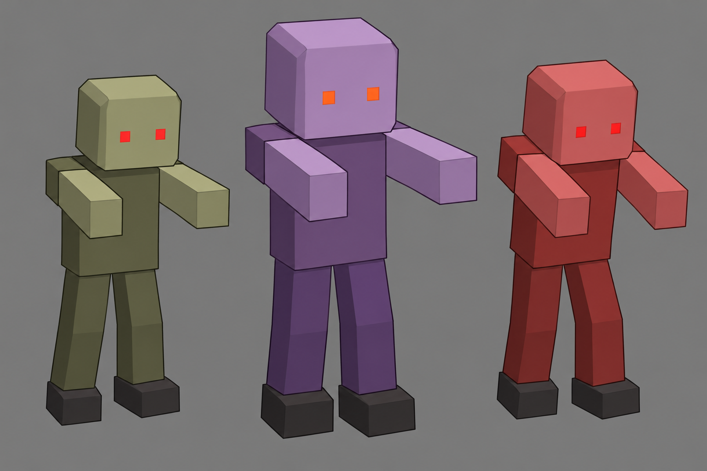
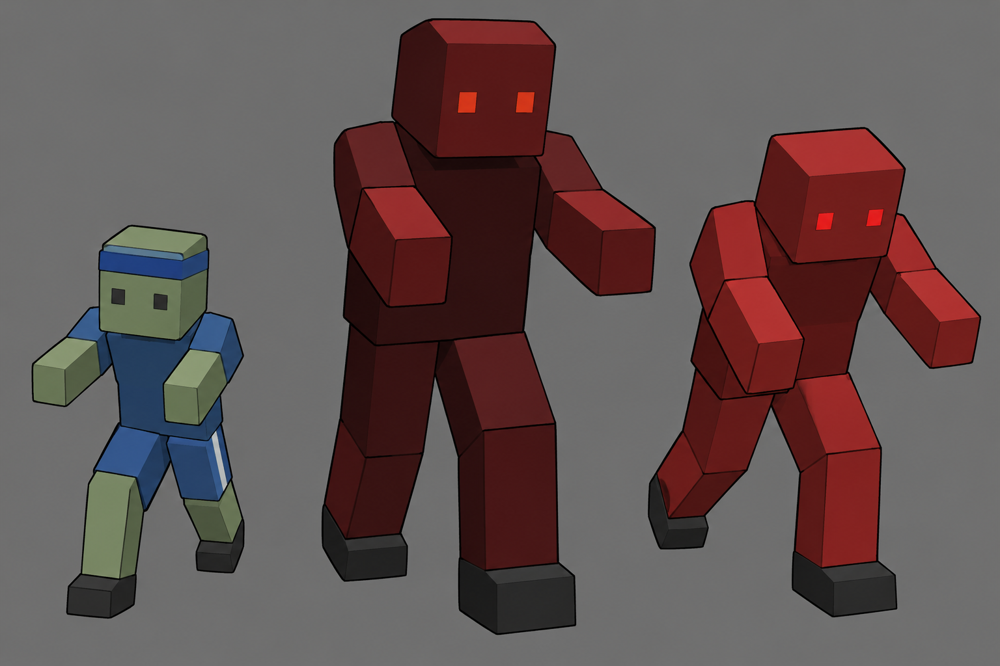
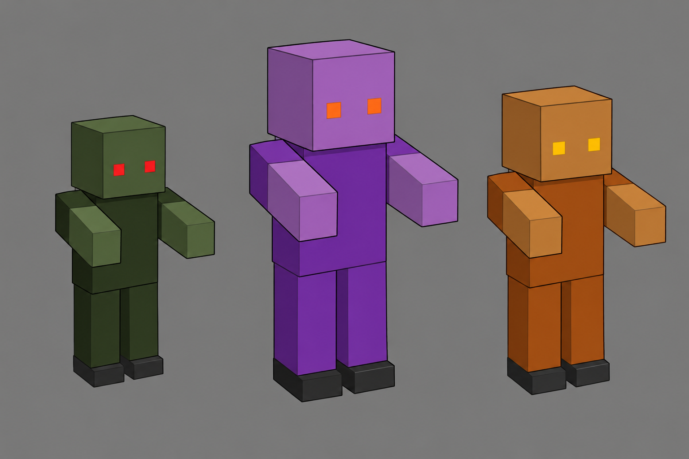

# Stage 1–4 스테이지별 좀비 콘셉트 기획

작성일: 2026-10-24
상태: 현행 박스형 런타임 메시를 따르는 구현 참고 원화. 런타임 변경이나 새 좀비 타입 승인을 뜻하지 않는다.

## 기획 기준

현행 좀비 메시를 확인한 결과, 일반형은 챔퍼 박스 머리·몸통·팔·다리와 작은 손·발·눈 파츠로 구성된 단순한 조립식 모델이다. 따라서 스테이지마다 3종, 총 12개 기획 슬롯은 기존 박스 형태와 팔레트·스케일·동작 역할을 조합해 보여준다. 스테이지 테마를 위한 앞치마·가방·식판·종이·추가 복장 파츠는 현재 모델에 없으므로 원화와 제안에서 제거했다. 기존 공통형 좀비가 스테이지 간 공유되므로, 이 문서는 스테이지마다 별도 외형이 이미 구현된 것처럼 묘사하지 않는다.

실제 공통 구현 흐름은 [시각 구현 방식 기록](../Graphic_designer/stage_zombie_visual_method_20261023.md)에 정리했다. 새 원화는 몇 개의 불투명 박스 파츠, 기존 툰 재질·외곽선, 어깨·골반 피벗만을 보여주는 블록아웃 참고도다. 게임 모델·텍스처·리깅 결과물이 아니다.

## 스테이지별 콘셉트

### Stage 1 — 교실 생존

현재 이름은 `교실 생존`이다. 교실에서 기본 추격과 밀도, 빠른 적, 탱커, 차저·거대 적의 조합으로 생존 압박을 만든다. B01 수학 교사는 보스이므로 이번 일반 좀비 3종에는 포함하지 않는다.

| 콘셉트 | 참고 행동 | 실루엣·외형 |
|---|---|---|
| 기본 추격 박스 좀비 | 기본 추격 E01 | 공통 박스 머리·몸통·앞으로 뻗은 팔·두 다리와 작은 눈으로 구성한다. E01 기존 팔레트만 사용한다. |
| 대형 박스 탱커 | 탱커 E02 | 같은 파츠 구성을 크게 표시하고 E02 기존 팔레트를 쓴다. 새 갑옷·가방·방패 파츠는 추가하지 않는다. |
| 전방 기울임 박스 차저 | 차저 E05 | 같은 박스 메시를 유지한다. 진행 방향으로 숙이는 차저 동작으로 구분하며 새 장식은 더하지 않는다. |

### Stage 2 — 복도 투사체 시험

현재 이름은 `복도 투사체 시험`이다. 길고 좁은 복도에서 원거리 투사체와 근접 추격이 겹친다. 일반형 E03·E02·E04는 현재 같은 기본 박스 메시를 공유하므로, 원화도 그 형태를 바꾸지 않고 기존 크기·색상·행동 차이만 표시한다. 별도 복도 소품이나 경비 복장은 추가하지 않는다.

| 콘셉트 | 참고 행동 | 실루엣·외형 |
|---|---|---|
| 소형 박스 러너 | 러너 E03 | 공통 박스 메시를 작게 표시한다. 빠른 러너 역할은 기존 이동 동작으로 구분하고 장식은 추가하지 않는다. |
| 대형 박스 탱커 | 탱커 E02 | 기본 박스 파츠를 확대하고 E02의 기존 보라 계열 팔레트를 사용한다. |
| 원거리 박스 좀비 | 원거리 E04 | 공통 메시와 E04 팔레트를 유지한다. 원거리 역할은 기존 투사체 행동이며 손에 새 무기 소품을 만들지 않는다. |

### Stage 3 — 체육관 총력전

현재 이름은 `체육관 총력전`이다. 체육관 아레나의 전방위·다축 압박과 기존 달리기 크루가 시그니처다. Stage 3의 RZC는 공통 기본형과 달리 이미 구현된 단순 체육복·머리띠 박스 파츠를 쓴다. E06·E05는 각각의 기존 박스형 팔레트와 스케일·동작을 유지한다. B03 교사 보스 파츠는 일반 좀비에 섞지 않는다.

| 콘셉트 | 참고 행동 | 실루엣·외형 |
|---|---|---|
| 박스형 런 크루 | 런 크루 RZC | 현행 RZC의 기존 박스 머리띠·체육복 줄 파츠만 표시한다. 작은 크기와 달리기는 현재 타입 특성이다. |
| 대형 박스 엘리트 | 엘리트 E06 | 공통 박스 메시를 확대해 E06의 기존 어두운 적색 팔레트로 표시한다. 추가 보호대나 공 소품은 없다. |
| 적색 박스 차저 | 차저 E05 | 공통 박스 메시와 E05 팔레트를 사용하고 현재 차저 동작으로만 구분한다. 새 체육복 장식은 추가하지 않는다. |

### Stage 4 — 급식실 대탈출

현재 이름은 `급식실 대탈출`이며 현재 런타임 보스는 B04 주방장이다. E03·E02·E04 일반 좀비는 현재 다른 스테이지와 같은 공통 박스 메시와 타입별 팔레트·크기를 쓴다. 급식실 테마를 이유로 런타임에 없는 식판·앞치마·급식표 파츠를 그리지 않는다.

| 콘셉트 | 참고 행동 | 실루엣·외형 |
|---|---|---|
| 소형 박스 러너 | 러너 E03 | Stage 2와 같은 E03 기본 메시·팔레트·크기다. 스테이지 장소만으로 새 외형이 생기지는 않는다. |
| 대형 박스 탱커 | 탱커 E02 | Stage 2와 같은 E02 기본 메시·팔레트·크기다. 식판이나 앞치마 파츠를 추가하지 않는다. |
| 원거리 박스 좀비 | 원거리 E04 | Stage 2와 같은 E04 기본 메시·팔레트·크기다. 새로운 원거리 장비는 추가하지 않는다. |

## 기존 구현과 연결할 때 지킬 점

- 역할은 기존 동작을 빌린다. 새 패턴, 공격 판정, 상태이상, 이동 규칙, 웨이브·스폰 수, HP·속도·피해·보상 수치를 추가하지 않는다.
- 현재 E 타입은 스테이지 간 공유되며 같은 타입의 시각 메시도 공통이다. 그러므로 Stage 2와 Stage 4처럼 같은 E 타입을 쓰는 스테이지의 원화는 동일한 외형으로 그렸다. 스테이지 전용 외형을 만들려면 ID·렌더 경로와 저장·Studio 연결을 함께 설계하는 별도 승인된 구현 결정이 필요하다. 이 문서는 새 ID를 정하지 않는다.
- 신규 ID가 추후 승인되면 타입 코드·런타임 슬롯·팔레트·인스턴스 파츠·애니메이션·Studio 연결과 대응 테스트를 빠짐없이 함께 검토한다. 별도 파츠를 추가해도 공용 형태·재질·외곽선·피벗 원칙을 유지한다.
- 구현 참고 원화는 현행처럼 머리·몸통·팔·다리와 발·손·눈의 박스 파츠만 사용한다. 피부·몸 색, 눈 색, 타입에 이미 구현된 스케일·동작 외의 복장·소품·질감은 표현하지 않는다. 어깨와 몸통을 분리해 틈을 내거나 내부가 비치는 형태도 사용하지 않는다.
- 현재 Stage 4를 옥상으로 고르는 낡은 제안은 활성 콘셉트로 취급하지 않았다. `Planner/stage4_concept_wave_plan_2026-07-18.md`는 당시 옥상을 권고했지만 현재 `stageConfig.js`와 2026-10-19 고정 Stage 04 문서는 급식실을 가리킨다.

## 확인한 기준 문서·코드

- 현행 Stage 1–4 제목: `Developer/r3f_prototype/src/lib/stageConfig.js:22-106`.
- 스테이지별 고정 구현 스냅샷: `Planner/stage1_10_balance_implementation_20261019/stage01.md`–`stage04.md`. 이 문서는 생성 시점의 스냅샷이므로 실제 현재 동작 수치는 코드와 다를 수 있다.
- 역할·수치의 현재 기준: `Developer/r3f_prototype/src/components/Enemy.jsx:341-371`.
- 일반 좀비 팔레트와 메시 구성: `Developer/r3f_prototype/src/components/ZombieMesh.jsx:21-35,356-368,1091-1129`.
- 기본 인스턴스 슬롯·팔레트·단순 파츠: `Developer/r3f_prototype/src/components/ZombieInstanceLayer.jsx:22-37`.
- 타입 코드·이름 레지스트리: `Developer/r3f_prototype/src/lib/enemyEntityPool.js:7-45`.
- 스테이지별 버스트 연결: `Developer/r3f_prototype/src/lib/burstEvents.js:138-288`.
- 캐릭터 그래픽 원칙: `Graphic_designer/Concept_Rules/stage_graphic_cons.md`.

## 원화 파일

제작 프롬프트와 해시를 포함한 파일 목록은 [박스 메시 구현 참고 원화 기록](../Graphic_designer/stage_zombie_blockout_20261024/README.md)을 참고한다. 네 이미지는 현행 런타임 메시를 설명하는 참고도이며 게임에 자동 포함되거나 캐릭터를 바꾸지 않는다. 이전 상세 콘셉트 시트는 [과거 콘셉트 원화 기록](../Graphic_designer/stage_zombie_concepts_20261023/README.md)에 보관한다.
